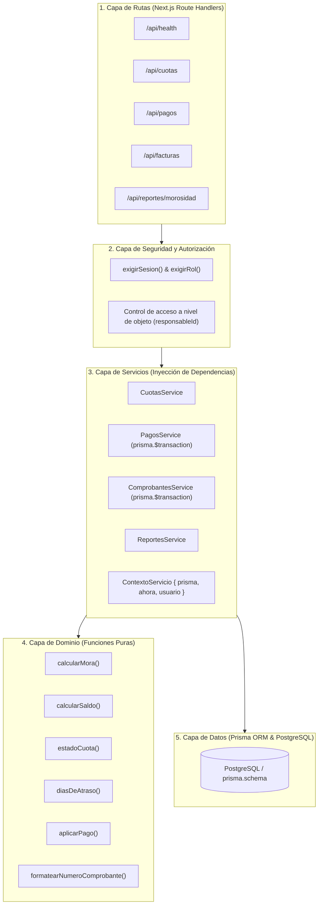

# Módulo de Cobranzas y Facturación - Sumaq Workflow

## 1. Arquitectura por Capas

El módulo está diseñado siguiendo los principios de arquitectura limpia y separación estricta de responsabilidades, desacoplando la lógica de negocio pura de la base de datos (Prisma) y del framework web (Next.js).



---

## 2. Reglas de Negocio

1. **Moneda y Redondeo:** Moneda oficial en Soles (PEN). Redondeos matemáticos estrictos a dos decimales.
2. **Cálculo de Mora:**
   - Sin periodo de gracia: el día siguiente al vencimiento cuenta como 1 día de atraso (calculado en zona horaria `America/Lima`, UTC-5).
   - Fórmula: $\text{Mora} = \min(\text{montoBase} \times 0.005 \times \text{diasAtraso}, \text{montoBase} \times 0.20)$.
3. **Imputación de Pagos:**
   - Todo pago amortiza primero el interés moratorio vigente acumulado.
   - El saldo restante se imputa directamente al saldo capital.
   - Si el monto recibido excede la deuda exigible (Capital + Mora), la transacción es rechazada con código `MONTO_EXCEDE_ADEUDO`.
4. **Idempotencia:**
   - Si una solicitud `POST /api/pagos` envía la cabecera `Idempotency-Key`, y ya existe un pago previo con dicha clave, el sistema devuelve `200 OK` con el pago original sin registrar duplicados ni cobrar dos veces.
5. **Inmutabilidad de Comprobantes:**
   - Una vez emitido un comprobante, no puede modificarse (`PUT`, `PATCH`) ni eliminarse (`DELETE`), retornando error `409 COMPROBANTE_INMUTABLE`.

---

## 3. Tabla de Códigos de Error

| Código HTTP | Código Interno | Descripción |
|---|---|---|
| 400 | `DATOS_INVALIDOS` | Faltan campos requeridos o tipos de datos incorrectos |
| 400 | `MONTO_INVALIDO` | El monto es menor o igual a cero o no numérico |
| 400 | `MONTO_EXCEDE_ADEUDO` | El monto a pagar excede el total adeudado (capital + mora) |
| 401 | `NO_AUTORIZADO` | No existe sesión activa en NextAuth |
| 403 | `ACCESO_DENEGADO` | El rol del usuario no tiene permisos suficientes |
| 404 | `CLIENTE_NO_ENCONTRADO` | El cliente indicado no existe |
| 404 | `CUOTA_NO_ENCONTRADA` | La cuota no existe o pertenece a un cliente ajeno (COBRANZAS) |
| 404 | `PAGO_NO_ENCONTRADO` | El pago no existe o pertenece a un cliente ajeno (COBRANZAS) |
| 404 | `COMPROBANTE_NO_ENCONTRADO` | El comprobante no existe o el cliente asignado es ajeno |
| 409 | `CUOTA_DUPLICADA` | Ya existe una cuota con el mismo número para el cliente |
| 409 | `CUOTA_YA_PAGADA` | La cuota ya está cancelada al 100% |
| 409 | `PAGO_YA_FACTURADO` | El pago ya cuenta con una factura/comprobante emitido |
| 409 | `COMPROBANTE_INMUTABLE` | Se intentó modificar o eliminar un comprobante emitido |
| 500 | `ERROR_INTERNO` | Error imprevisto en el servidor (sin trazas ni datos sensibles) |

---

## 4. Uso de la Semilla de Datos

Para inicializar los escenarios de prueba en desarrollo:

```bash
# Ejecutar semilla mediante script configurado
npm run db:seed
```

### Escenarios creados:
- **Cliente A:** Al día (3 cuotas futuras de S/ 500, sin pagos).
- **Cliente B:** Atraso corto (cuota de S/ 500 vencida hace 5 días, mora S/ 12.50).
- **Cliente C:** Atraso prolongado (cuota de S/ 500 vencida hace 120 días, mora saturada en S/ 100.00).
- **Cliente D:** Pago parcial (cuota de S/ 500 vencida hace 10 días con pago de S/ 200).
- **Cliente E:** Cuota pagada y facturada con comprobante `F001-00000001`.
- **Cliente F:** Asignado a un segundo cobrador para probar aislamiento entre gestores.

---

## 5. Ejemplos de Llamadas en PowerShell (`Invoke-RestMethod`)

### 5.1 Verificación de Salud
```powershell
Invoke-RestMethod -Uri "http://localhost:3000/api/health" -Method Get
```

### 5.2 Listar Cuotas
```powershell
Invoke-RestMethod -Uri "http://localhost:3000/api/cuotas?pagina=1&limite=10" -Method Get
```

### 5.3 Registrar Pago con Idempotencia
```powershell
$headers = @{
    "Content-Type" = "application/json"
    "Idempotency-Key" = "TRANS-TEST-0001"
}
$body = @{
    cuotaId = "id-de-la-cuota"
    monto = 500.00
    metodo = "TRANSFERENCIA"
    referencia = "REF-BCP-987654"
} | ConvertTo-Json

Invoke-RestMethod -Uri "http://localhost:3000/api/pagos" -Method Post -Headers $headers -Body $body
```

### 5.4 Emitir Factura
```powershell
$body = @{
    pagoId = "id-del-pago"
} | ConvertTo-Json

Invoke-RestMethod -Uri "http://localhost:3000/api/facturas" -Method Post -ContentType "application/json" -Body $body
```

### 5.5 Consultar Reporte de Morosidad
```powershell
Invoke-RestMethod -Uri "http://localhost:3000/api/reportes/morosidad" -Method Get
```
